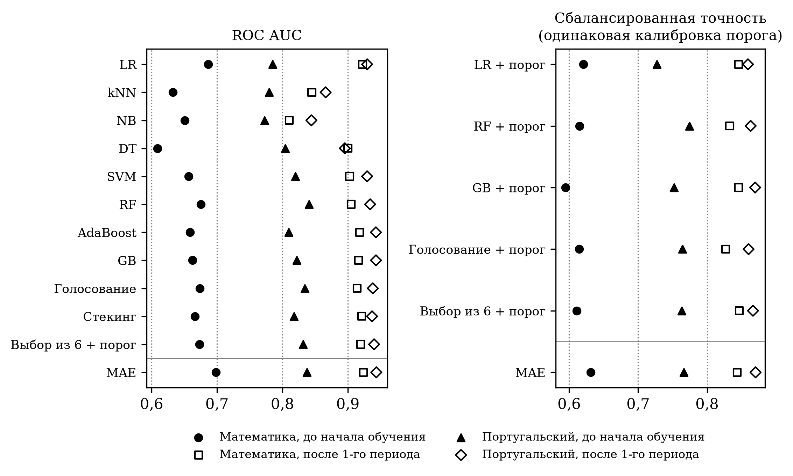

# Multi-agent ensemble of classical ML models for early identification of at-risk students

[](https://colab.research.google.com/github/Msakhibullin24/A-multi-agent-ensemble-of-classical-machine-learning-models-/blob/main/notebooks/MAE_walkthrough.ipynb)
[](LICENSE)
[](https://doi.org/10.5281/zenodo.23729260)

**Авторы / Authors:**
- Минтимер Мансурович Сахибуллин (Mintimer M. Sakhibullin) — Казанский государственный институт культуры
- Римма Хамидовна Гильмеева (Rimma Kh. Gilmeeva) — Институт педагогики, психологии и социальных проблем, Казань

Код, данные и результаты к статье «Мультиагентный ансамбль классических моделей машинного обучения для раннего выявления обучающихся группы академического риска» (направлена в журнал). Code, data and results accompanying the article.

---

## Коротко (RU)

Задача: заранее найти учащихся, которые могут не сдать предмет (итоговая оценка G3 < 10 из 20), чтобы педагог успел помочь.

Модель MAE (Multi-Agent Ensemble) устроена как команда агентов:

| Агент | Что делает |
|---|---|
| Эксперты: «Академический», «Семейно-социальный», «Поведенческий», «Общий» | Каждый смотрит на свою группу признаков и сам выбирает классическую модель: LR, SVM, kNN, NB, RF или GB |
| Координатор | Взвешивает мнения экспертов по их компетентности: общей и на похожих учащихся |
| Калибровщик | Подбирает порог «группа риска» по индексу Юдена |
| Интерпретатор | Раскладывает итоговый риск на вклады экспертов |

Сравнение проводилось с десятью классическими моделями и ансамблями и с контрольными моделями, у которых тот же калибровщик порога. Протокол: повторённая кросс-валидация 5×5, скорректированный t-критерий Надо — Бенжио, поправка Холма.

Главный вывод:
- по точности MAE находится на уровне лучших классических ансамблей (бустинг, случайный лес), но статистически их не превосходит;
- её преимущество — интерпретируемость: риск раскладывается по педагогически понятным группам факторов.

## Summary (EN)

Goal: early detection of students who may fail a course (final grade G3 < 10 out of 20).

The MAE consists of agents:
- **expert agents** (academic, family/social, behavioural, general), each of which picks its own classical model;
- a **coordinator** that weights the experts by competence;
- a **threshold calibrator** (Youden's index);
- an **interpreter** that splits the risk score into expert contributions.

Evaluation: 5×5 repeated CV, corrected resampled t-test with Holm correction. The comparison covers ten classical models/ensembles and control models with the same threshold calibration.

Result: MAE matches, but does not significantly beat, the best classical ensembles. Its added value is structural interpretability.

## Основные результаты / Key results

ROC AUC (среднее по 25 разбиениям / mean over 25 CV splits):

| Модель / Model | Мат., до обучения | Мат., после 1-го периода | Порт., до обучения | Порт., после 1-го периода |
|---|---|---|---|---|
| Logistic regression | 0.687 | 0.922 | 0.785 | 0.929 |
| Random forest | 0.675 | 0.905 | **0.840** | 0.934 |
| Gradient boosting | 0.662 | 0.916 | 0.822 | **0.943** |
| Stacking | 0.666 | 0.921 | 0.818 | 0.937 |
| **MAE** | **0.698** | **0.924** | 0.837 | **0.943** |

Полные таблицы — в `results/`, разбор — в ноутбуке. Full tables are in `results/`, walkthrough is in the notebook.



## Структура / Structure

| Путь / Path | Содержимое / Contents |
|---|---|
| `notebooks/MAE_walkthrough.ipynb` | Пошаговый разбор: данные → агенты → сравнение → объяснение для педагога (запускается в Colab) |
| `src/mae.py` | Мультиагентный ансамбль и калибровщик порога |
| `src/experiment.py` | Полный эксперимент (все модели × 4 задачи × CV 5×5, статистика) |
| `src/figures.py` | Рисунки и пример работы интерпретатора |
| `results/` | Метрики (`*_metrics.csv`), тесты (`*_tests.csv`, столбец `p_holm`), сводка (`summary.json`) |
| `figures/` | Рисунки (300 dpi) |
| `data/` | UCI Student Performance |

## Запуск / How to run

```bash
python -m venv .venv && .venv/bin/pip install -r requirements.txt
.venv/bin/python src/experiment.py   # ~25 мин на 12 ядрах / ~25 min on 12 cores; resumable
.venv/bin/python src/figures.py
```

Проверено на / tested with: Python 3.12, scikit-learn 1.9.1, pandas 3.1.0, numpy 2.5.4. Зерно генератора фиксировано (`SEED = 42`). Fixed random seed.

## Данные / Data

Cortez P. Student Performance [Dataset]. UCI Machine Learning Repository, 2008. https://doi.org/10.24432/C5TG7T. Лицензия / licence: CC BY 4.0.

Cortez P., Silva A. Using Data Mining to Predict Secondary School Student Performance // Proc. FUBUTEC 2008. P. 5–12.

## Цитирование / Citation

Sakhibullin M.M., Gilmeeva R.Kh. Multi-agent ensemble of classical machine learning models for early identification of students at academic risk (v1.0.0). Zenodo, 2026. https://doi.org/10.5281/zenodo.23729260

См. также `CITATION.cff` (кнопка «Cite this repository» справа на странице GitHub). See also `CITATION.cff`.

## Лицензия / License

Код — MIT. Данные — CC BY 4.0 (UCI). Code: MIT. Data: CC BY 4.0 (UCI).
